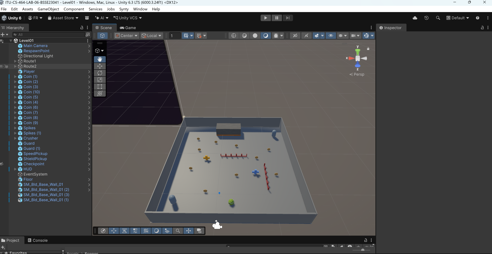
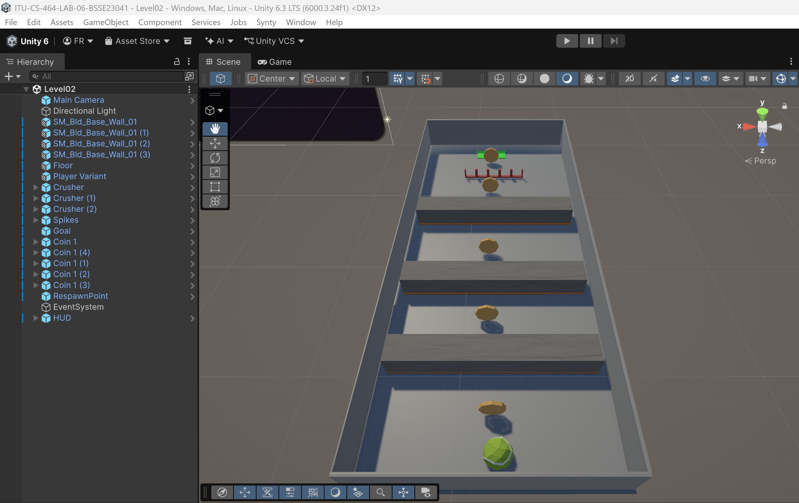
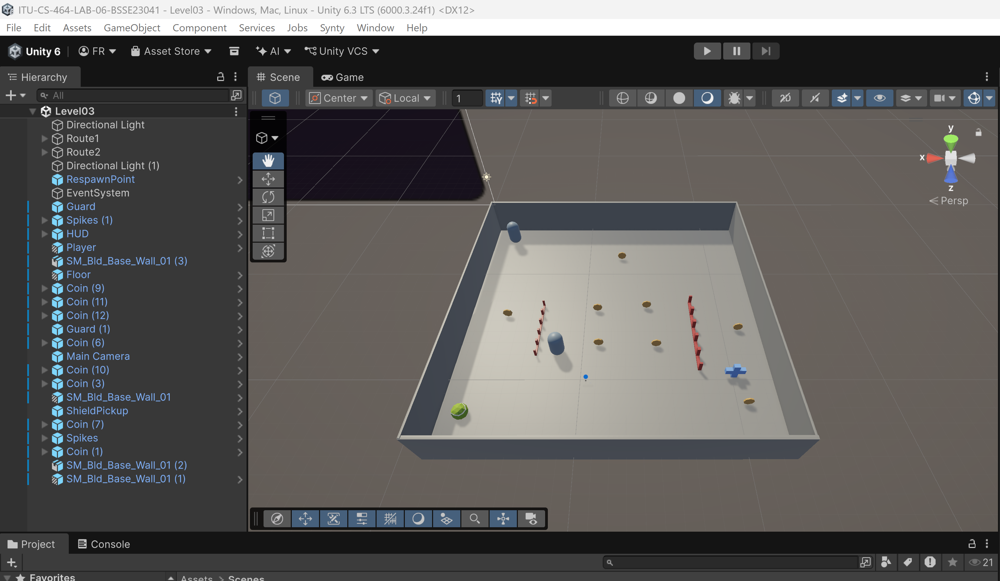
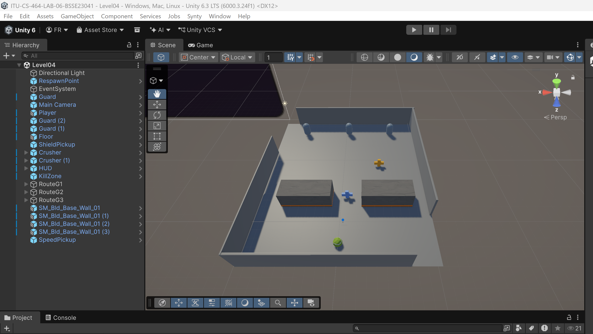
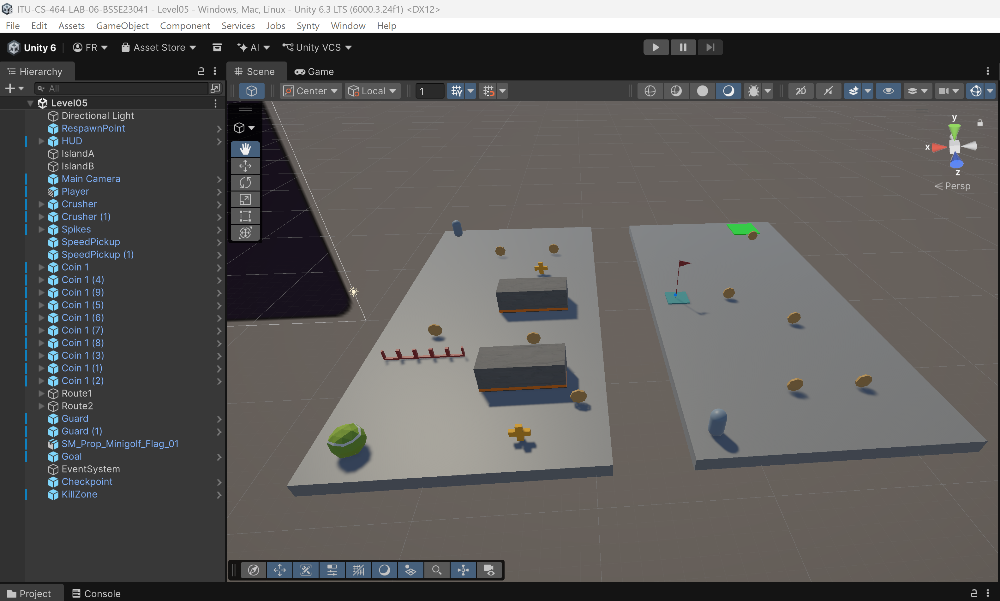

# ITU CS464 Lab 06
## Gameplay Video
**Video Link:** [(https://youtu.be/1k1kDlBAnzw)]

## Game Levels

## Game Levels

| Level | Name | Screenshot | Description | Objective |
|---|---|---|---|---|
| Level 01 | Arena |  | An open arena with guards, spikes, a crusher and power ups. | Collect all 10 coins. |
| Level 02 | Hot Corridor |  | A narrow corridor with timed crushers and spikes. | Collect at least 3 coins and reach the goal within 40 seconds. |
| Level 03 | Hide & Seek |  | Two guards patrol different routes and chase the player when nearby. | Collect all 8 coins while avoiding guards. |
| Level 04 | Last Stand |  | A small arena with three chasing guards, two crushers and dangerous gaps. | Survive for 40 seconds. |
| Level 05 | Gauntlet |  | Two islands with a gap between them, guards, hazards and power ups. | Collect all 10 coins and reach the goal within 90 seconds. |

## Tools Used

Unity 6.3

C#

Visual Studio Code

Git and GitHub